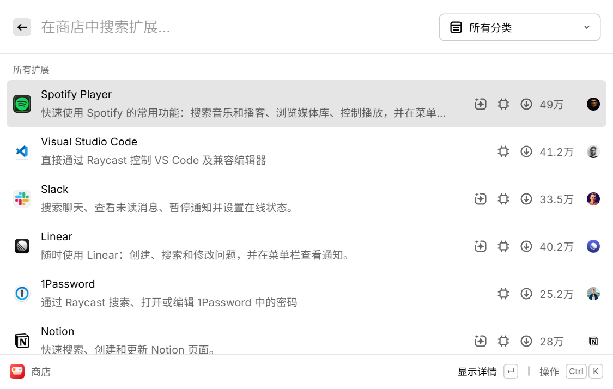
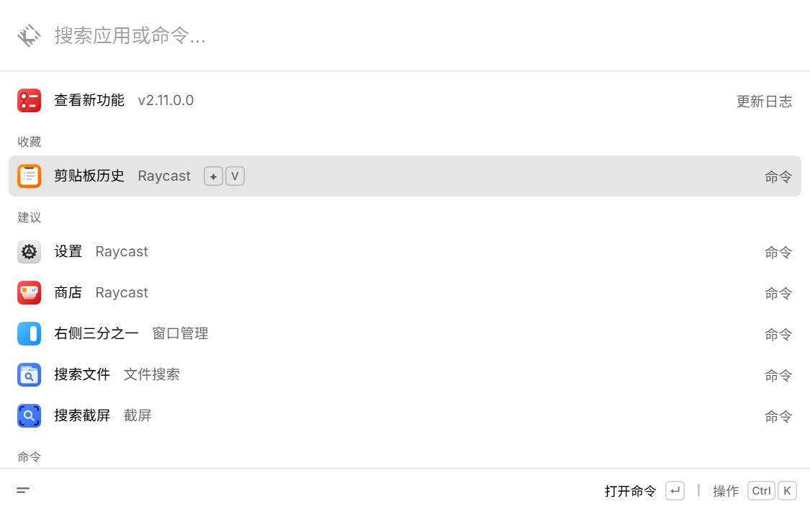

# Raycast Windows 汉化

Raycast Windows Simplified Chinese Localization，支持主界面、设置、商店、更新日志和热门插件。非官方项目。

**适配 Microsoft Store 版 Raycast 2.12.1.0 x64。**

[下载 Windows 版](https://github.com/zwjtano/raycast-windows-zh-CN/releases/latest) · [macOS 版](https://github.com/zwjtano/raycast-macos-zh-CN)

## 安装与卸载

1. 下载并完整解压。更新前先运行新版包内的 `卸载汉化.cmd`。
2. 从托盘退出 Raycast，双击 `安装汉化.cmd`，允许管理员授权。
3. 正常打开 Raycast 即可。

卸载：双击 `卸载汉化.cmd`。遇到问题可运行 `检查状态.cmd`。

## 汉化范围

涵盖 Windows 热门榜前十页的 [100 个插件](docs/extensions.md)，插件需自行安装。部分动态内容和托盘菜单仍为英文。

## Windows 插件移植

[哔哩哔哩搜索中文版](https://github.com/zwjtano/raycast-windows-zh-CN/releases/tag/bilibili-search-windows-v1.0.0) · [官方商店适配 PR](https://github.com/raycast/extensions/pull/32048)

## 注意

Raycast 更新后需使用对应版本的汉化包。本组件使用本机调试接口，仅支持单用户场景。插件修改有备份，卸载时恢复；手动修改冲突会提示处理。

[验证范围](docs/validation.md) · [汉化边界](docs/boundaries.md) · [第三方许可](THIRD-PARTY-NOTICES.md)

## 开发

`npm ci` → `npm run test:fast` → `npm test` → `npm run build` → `npm run package`

按改动范围单独运行，不必每次跑全量：

| 改动 | 命令 |
| --- | --- |
| `translations/*.json` 词典与更新日志 | `npm run test:dictionary` |
| `src/inject.js`、`transform.mjs`、`agent.mjs` | `npm run test:translation` |
| `plugin-*.cjs` 插件转换 | `npm run test:plugins` |
| `store-transform.mjs` 商店表达式 | `npm run test:store` |
| `setup.ps1` 安装与卸载 | `npm run test:install` |
| `dist/` 打包产物（先 build，且需已安装对应版本 Raycast） | `npm run test:package` |

`npm run test:fast` 只跑前四组，都不依赖本机 Raycast；提交前建议再跑一次 `npm test`。译文改动还可用 `npm run audit:ui` 连接正在运行的 Raycast，按[汉化边界](docs/boundaries.md)复核界面残留。

构建需安装上述版本的 Raycast。
